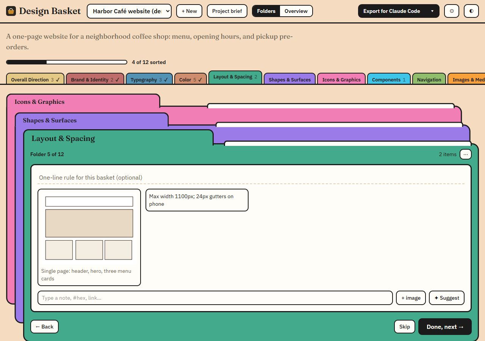
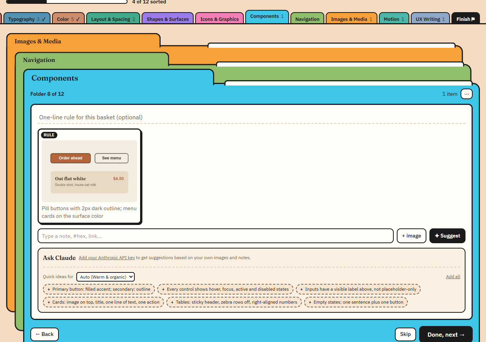
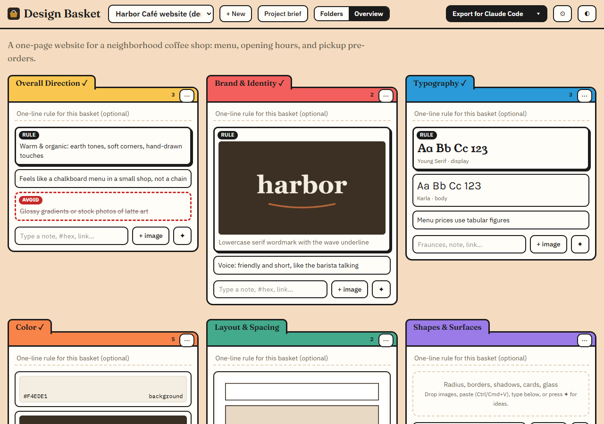
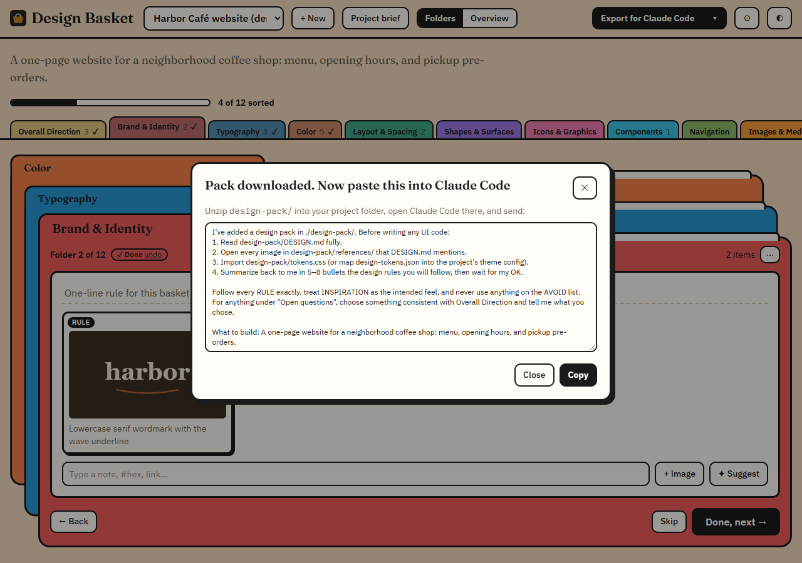
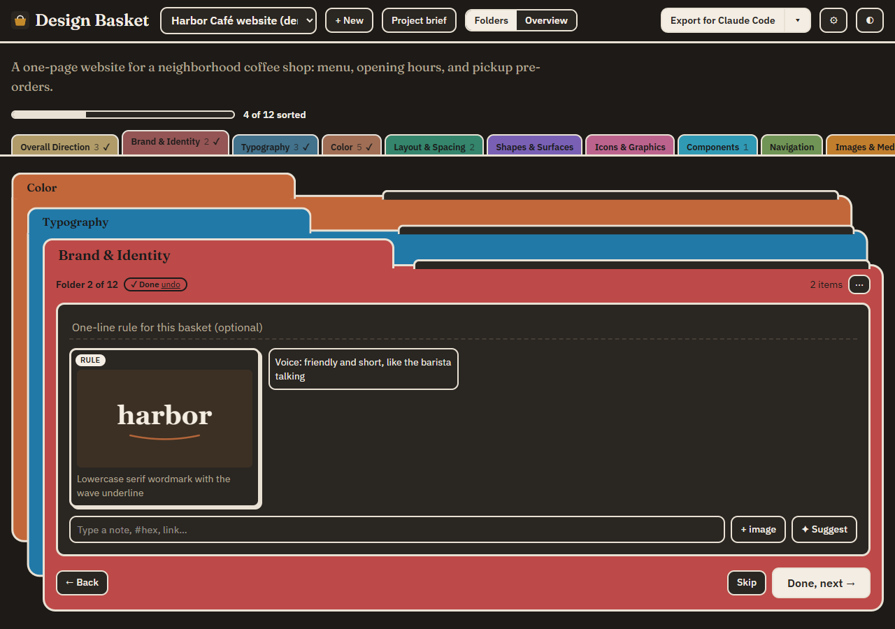
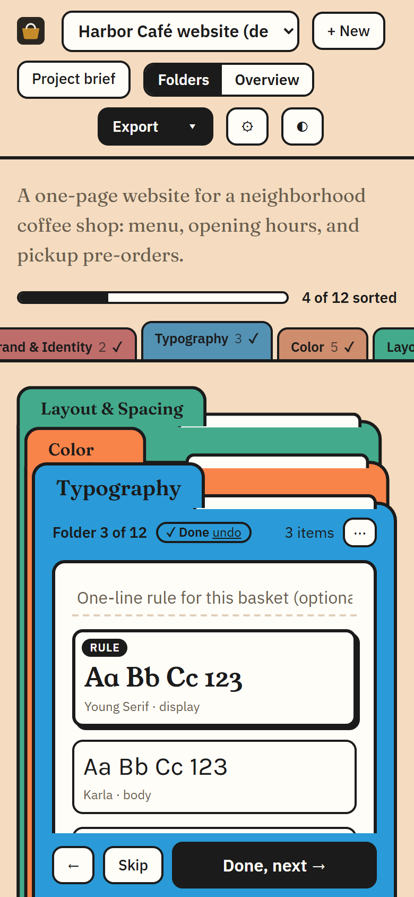

<div align="center">

# 🧺 Design Basket

**Collect design references in folders, then hand Claude Code a brief it can actually follow.**

Drop in logos, colors, fonts, screenshots and notes. Mark each one as a rule, an inspiration, or something to avoid.
One click exports a design pack: a written brief, design tokens, and every reference image, ready for Claude Code.



</div>

## Why

Before building a site you collect references: a logo you like, a color palette, a button style, a screenshot of a navbar. They end up scattered across screenshots, Pinterest boards and notes. An AI coding agent never sees them, so it invents a style of its own.

Design Basket puts every reference into one of 12 folders (Brand, Typography, Color, Layout, Components, Motion…) and turns the lot into instructions an agent can follow exactly.

## Features

- **One folder at a time.** Work through the stack, press **Done, next**, and watch the progress bar fill. Skipped folders become "open questions" in the brief, so the agent knows what to decide on its own.
- **Every way to add things.** Drag files onto a folder, paste an image with Ctrl/Cmd+V, pick files, or type. Typing `#FF5733 #1E3A5F` creates two swatches, a Google Fonts name creates a font preview, and a URL becomes a link.
- **Rule, Inspiration, Avoid.** Each item carries a priority, so the brief separates "match this exactly" from "just the vibe" from "never do this".
- **Suggestions.** Every folder has quick ideas tuned to your style (minimal, editorial, playful, brutalist, luxury, tech, warm). Add your own Anthropic API key and Claude will look at your images and notes and suggest what each folder is missing.
- **The export.** `DESIGN.md`, `design-tokens.json`, `tokens.css`, your images sorted into folders, and the exact message to paste into Claude Code.
- **Local-first.** No account and no server. Everything lives in your browser (IndexedDB), with backup and restore as a `.basket.zip`.
- Light and dark mode, works on a phone, keyboard reachable, respects reduced motion.

<table>
  <tr>
    <td width="50%"><br><sub><b>Suggestions</b> tuned to your chosen style, plus Claude if you add a key</sub></td>
    <td width="50%"><br><sub><b>Overview</b> shows every folder at once for bulk moves</sub></td>
  </tr>
  <tr>
    <td width="50%"><br><sub><b>Export</b> downloads the pack and gives you the message to paste</sub></td>
    <td width="50%"><br><sub><b>Dark mode</b> follows your system, with a manual toggle</sub></td>
  </tr>
</table>

<p align="center"></p>

## Quick start

You need [Node.js](https://nodejs.org) 22.12 or newer.

```bash
git clone https://github.com/Harry-Verdeflor/design-basket.git
cd design-basket
npm install
npm run dev
```

Open http://localhost:5173. To see a finished example, open **⚙ Settings → Load demo project**.

## From references to a built site

1. **Fill the folders.** Start with Overall Direction; your style there tunes the suggestions in every other folder.
2. **Mark priorities.** Click any item to set Rule, Inspiration or Avoid, give colors a role (primary, background…) and fonts a role (display, body…).
3. **Export for Claude Code.** You get `design-pack-<project>.zip`.
4. **Unzip it into your code project** and paste the message from the export dialog into Claude Code. Claude reads the brief, opens the images, imports the tokens, and summarizes the rules back to you before writing any UI.

## What the pack contains

```
design-pack/
├── DESIGN.md                    the brief Claude Code reads first
├── design-tokens.json           colors and fonts that have a role
├── tokens.css                   the same tokens as CSS variables
├── references/
│   ├── brand/01-lowercase-serif-wordmark-with-rule.webp
│   ├── components/01-pill-buttons-with-2px-dark-rule.webp
│   └── …                        one folder per basket that has images
└── PASTE_INTO_CLAUDE_CODE.txt   the message to paste
```

Browse a real one made from the demo project: **[docs/example-pack](docs/example-pack)** (start with [DESIGN.md](docs/example-pack/DESIGN.md)).

Tokens only come from items you gave a role, so the pack never invents values. Rules beat inspirations, and Avoid items never become tokens.

## Claude suggestions and your API key

Claude suggestions are optional. Without a key you still get the built-in quick ideas.

- Paste your key (from [console.anthropic.com](https://console.anthropic.com)) in **⚙ Settings**. Each request uses credits on your Anthropic account.
- **The key stays in your browser's local storage on your device.** The app has no server; your browser sends the key straight to `api.anthropic.com` and nowhere else. It never goes into your projects, backups or exports. **Remove key** in Settings deletes it.
- Anyone using the same browser profile can use the stored key, so don't save it on a shared computer.
- Choose Claude Sonnet 5.5 (default) or Claude Opus 5.5. Settings also lets you stop sending images, which makes each request cheaper.

## Scripts

| Command | What it does |
|---|---|
| `npm run dev` | Start the dev server |
| `npm run build` | Type-check and build to `dist/` |
| `npm run preview` | Serve the production build |
| `npm run test` | Run the unit tests (Vitest) |
| `npm run lint` | Lint with oxlint |
| `npm run screenshots` | Regenerate the README screenshots and `docs/example-pack` (needs `npm run dev` running and Chrome or Edge installed) |

## Built with

[Vite](https://vite.dev) · [React](https://react.dev) · TypeScript · [Tailwind CSS](https://tailwindcss.com) · [Dexie](https://dexie.org) (IndexedDB) · [JSZip](https://stuk.github.io/jszip/) · [dnd-kit](https://dndkit.com) · [Anthropic TypeScript SDK](https://github.com/anthropics/anthropic-sdk-typescript)

```
src/
├── App.tsx               header, views, drag and drop
├── db.ts                 IndexedDB schema and every write
├── components/           folder stack, overview trays, item panel, dialogs, suggestions
└── lib/
    ├── brief.ts          DESIGN.md, tokens and paste text (pure, tested)
    ├── zip.ts            pack export, backup and import
    ├── parse.ts          turns typed text into colors, fonts and links
    ├── suggest.ts        built-in suggestions and style detection
    ├── ai.ts             Claude requests and answer checking
    └── demo.ts           the café demo project
```

[DECISIONS.md](DECISIONS.md) explains the design choices and trade-offs.

## Contributing

Issues and pull requests are welcome. Before you open a PR, run `npm run build`, `npm run lint` and `npm run test`. If you change the UI, run `npm run screenshots` so the README pictures stay current.

## License

[MIT](LICENSE)
